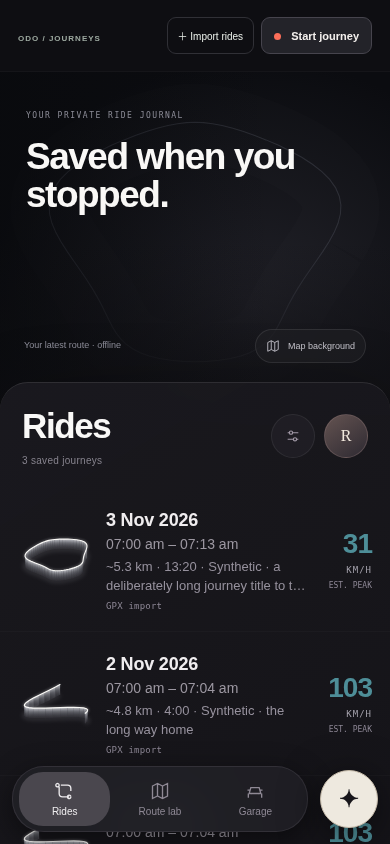

# Ride library

The library follows the supplied Ryval reference: a dark map cover, a rounded ride sheet, compact white raised route silhouettes, date/time and bike-or-title metadata, and a muted teal peak-speed column. The mobile dock keeps Rides, Route lab and Garage readable; the rider avatar opens all destinations, including Settings and private story drafts. The Odo companion sits beside the dock without covering the speed column.

[Desktop preview](previews/ride-library-desktop-synthetic.png). All displayed rides are synthetic fixtures used only by the browser check; the product does not seed sample recordings.

## Route previews and data

`route-relief.js` projects each actual route with geographic proportions, a fixed perspective and translucent vertical sides. The white rim, extrusion and glow are presentation styling, not altitude or terrain measurements. Separate GPS segments stay disconnected. Dateline crossings retain their local shape. Subpixel simplification and cached geometry keep previews lightweight without a WebGL context per row.

Peak speed comes from the same accepted source samples used by the detailed telemetry panel. GPX interval speeds are labelled EST. PEAK and distance remains an approximate geometric estimate. Missing speed displays an em dash and NO SPEED. GPS measurement accuracy and manufacturer-only channels are never inferred from the thumbnail.

The cover shows a faint local route by default. Map background asks before loading actual OpenStreetMap tiles around the latest ride; the provider then sees the viewed area and connection. The map has attribution and a Hide map action. Tile failures preserve the offline route. Map instances are released on navigation and page hide.

## Verified

- 69 Node tests, including connected geometry, dateline crossings, empty/stationary routes, altitude-independent styling and a 150,000-point projection.
- Chromium library checks at 320, 390, 650, 680, 768 and 1440 px: source labels, missing speed, filters, rider-menu access, detail navigation, consent cancellation and map failure/disposal.
- Companion, telemetry and native overlay browser smoke checks pass; model responses are mocked in these checks.
- Android debug assembly and lint pass with the new assets packaged. Physical-device appearance and GPU performance still need an on-device check.
