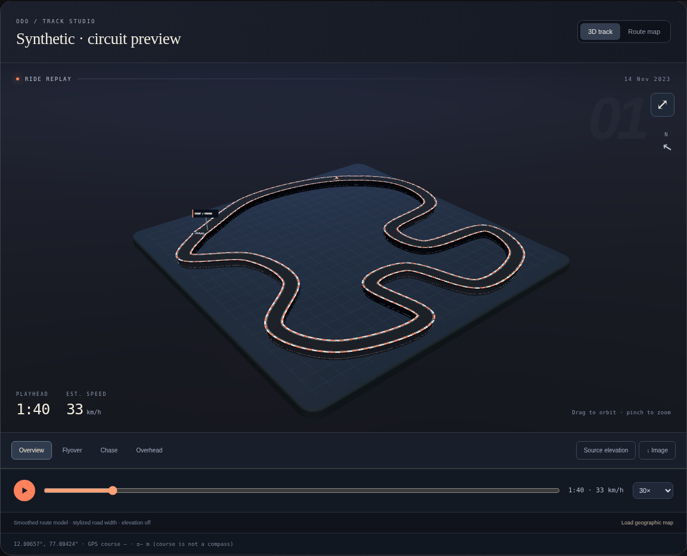

# 3D Track Studio

The ride-detail, overview and route-lab preview now render a physical road model locally in WebGL. Each connected recording segment becomes a raised asphalt ribbon with side walls, red/white kerbs, edge markings, lighting and shadows. A checkered finish and moving rider token give the replay a motorsport presentation. The token is illustrative, without simulated bike lean.

Drag to orbit, pinch/wheel to zoom, or choose Overview, Flyover, Chase and Overhead. Expand opens an immersive modal without replacing the active renderer or resetting the playhead; Escape restores the original layout. The north indicator follows the actual camera projection. Arrow keys orbit the focused canvas, +/- zoom, and 0 resets the camera. Portrait and landscape views fit the whole model automatically. Flyover honors reduced-motion preferences. Replay shares the existing speed/elevation/motion timeline and updates its instrument readouts. Backgrounding the page pauses replay. WebGL failure or context loss leaves a usable 2D route.

[Portrait screenshot](previews/track-studio-mobile.png) · [Expanded mobile view](previews/track-studio-expanded-mobile.png). These are synthetic test data, not an imported user ride.

## Source fidelity

- Longitude is unwrapped across the date line and horizontal axes use the same local scale. Curves are smoothed for presentation; road width, kerbs, markers and display plinth are stylized. This is a route preview, not a reconstruction of the actual road surface or terrain.
- Explicit segment boundaries and elapsed-time gaps split the mesh. Replay hides its rider token and reports unknown speed within gaps. Native recordings use a three-second connection threshold; GPX uses thirty seconds.
- GPX speed belongs to the interval ending at its sample. The preview holds this estimate through that interval. Native replay interpolates valid speed samples. Scrubbing to a sample shows its recorded/derived value.
- Elevation starts off. The control is available only for a complete, finite source altitude channel in the supported range. When enabled, altitude uses the same scale as horizontal distance, with no vertical exaggeration. Vertical extrema remain in mesh simplification. Altitude accuracy and datum remain unverified; mountains and measured ascent are not invented.
- Sparse, stationary or invalid data can fall back to a 2D view. Manufacturer sensors are not simulated.

## Export and privacy

The Save image action exports the current camera frame to PNG after confirming route-shape inclusion. Even an unlabelled shape can reveal locations. The exported frame has no coordinate or timestamp labels. Frame exports are bounded to the native image transport’s 2160×3840 limit. Android uses the existing private image provider/system share sheet; browsers download the PNG. No post or remote upload is made. Opening Track Studio makes no tile/API requests. Loading the separate geographic map requires the existing tile-provider consent.

## Renderer and checks

Three.js 0.160.1 is vendored from the official `three` npm package so browser and APK rendering work offline. Its MIT license is included at `web/vendor/three-LICENSE.txt`. Package integrity: `sha512-Bgl2wPJypDOZ1stAxwfWAcJ0WQf7QzlptsxkjYiURPz+n5k4RBDLsq+6f9Y75TYxn6aHLcWz+JNmwTOXWrQTBQ==`. There is no runtime package fetch. Three.js is graphics software, not a model inference provider; the application's model calls remain Meta-only.

Kerb geometry is combined into two meshes. Route simplification retains turn and vertical vertices, with separate original samples for time interpolation. Pixel ratio is capped at two and redraw is capped at about 33 fps. Scene resources and event handlers are released when navigating or changing views. Physical-phone rendering/performance still needs a device trial.

`node --test --test-isolation=none scripts/*.test.cjs` covers projection, gaps, source altitude, GPX interval speed and a 50,000-point recording. With the local server running, `node scripts/track-smoke.cjs` exercises actual WebGL rendering in Chromium, cameras, playback, PNG download, tile-consent cancellation, portrait layout, unavailable altitude, repeated scene disposal and WebGL fallback. Review screenshots use the explicitly labelled synthetic circuit in `scripts/track-fixture.cjs`; it is never seeded into the product.
